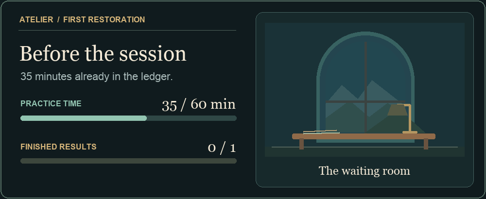

<h1 align="center">PROS</h1>

<p align="center"><strong>Personal RPG Operating System</strong></p>
<p align="center">A world for the work you come back to.</p>

<p align="center">
  <a href="#run-locally">Run locally</a> ·
  <a href="#the-atelier-turns-on-its-lights">See how it works</a> ·
  <a href="#the-canine-council">Meet the Council</a>
</p>


A shuttered studio sits by the river. There’s a cold forge in the hills and a telescope waiting for a lens. Pick something you want to practice, log the time you spend, and finish a piece of work. Bit by bit, the valley changes.

## The Atelier turns on its lights

Say you’ve put **35 minutes** into that guitar part. You practice for **25 more**, then add a finished recording as an output. The Atelier has the **60 minutes and one finished result** it needs to open its practice room.



One credited minute earns one character XP. Finish a result and it can leave a keepsake in the room. Take a week off and the room will be there when you return. [Still image](docs/assets/field-guide/atelier-still.webp)

## A desk to come back to

Pin one project to Today and start with the next action. Run a focus session or type `guitar 25m yesterday` to fill an activity draft you can review. Later, the Chronicle shows what your time went into.


*Today in the sample world. Start with **Explore a sample world** to look around with example progress.*

<details>
<summary><strong>Unfold the atlas</strong></summary>

| Region | What opens it up |
| --- | --- |
| **Observatory** | Learn a language, work through a book, or make sense of a question. |
| **Foundry** | Build a tool, fix something, or get a prototype working. |
| **Atelier** | Keep a take, a sketch, or a piece of writing. |
| **Training Grounds** | Develop a movement practice and record what you can do. |
| **Citadel** | Practice a conversation, plan a project, or work through a decision. |
| **Sanctuary** | Make time for focus, reflection, or a change in routine. |

Each region has three restoration stages. **Skills** has 26 starter paths and 48 more to discover, plus custom skills. **Character** holds the regional wardrobe and a small 3D wayfinder you can turn over. [Experience guide](docs/ENHANCEMENTS.md)

</details>

For a little noise from the listening room, try [*Homestead* by troubadour](public/audio/homestead.mp3), one of the app’s CC0 tracks. [Art and audio credits](public/licenses/THIRD-PARTY.txt)

## The Canine Council


| Freddie ✦ | Olive | Coco | Mungru |
| --- | --- | --- | --- |
| First chair, always. In memory. | The little white Spitz who guides you in PROS. | Minister of play. | Keeper of the good napping spots. |

<p align="center">
  <strong><a href="https://github.com/revaan-mishra">Revaan Mishra</a></strong><br>
  <em>Built at the desk. Supervised from the cushion.</em>
</p>

[Design notes](docs/MANIFESTO.md)

## Run locally

Use **Node.js 22 LTS** and **pnpm 9**.

```sh
git clone https://github.com/revaan-mishra/pros-app.git
cd pros-app
pnpm install --frozen-lockfile
pnpm dev
```

Open the address Vite prints. Choose **Explore a sample world** for a quick look or **Begin your journey** for a fresh device profile. A local build can run without a Firebase project.

For the production build, run `pnpm build` and then `node scripts/serve.mjs`. On macOS, **Start PROS.command** starts the built app at `http://127.0.0.1:4173`. Keep using the same browser and address, and save a JSON export from **Settings → Data and recovery** before moving your world. [Quick start](docs/QUICK-START.md)

<details>
<summary><strong>Build notes, records, and release status</strong></summary>

PROS stores records in your browser first. Backups are readable JSON and can contain private notes. Configured Firebase builds can synchronize records for verified accounts with approved access. The hosted release is pending. [Data recovery](docs/DATA-RECOVERY.md) · [Deployment](docs/DEPLOYMENT.md) · [Current repository status](docs/IMPLEMENTATION-CHECKPOINT.md)

```sh
pnpm test
pnpm check:assets
pnpm check:server
pnpm build
```

[](https://github.com/revaan-mishra/pros-app/actions/workflows/verify.yml)

</details>

[MIT License](LICENSE) · [Art and audio](docs/ART-AND-AUDIO.md) · [Security](SECURITY.md) · [Making the field guide](docs/SHOWCASE.md)
