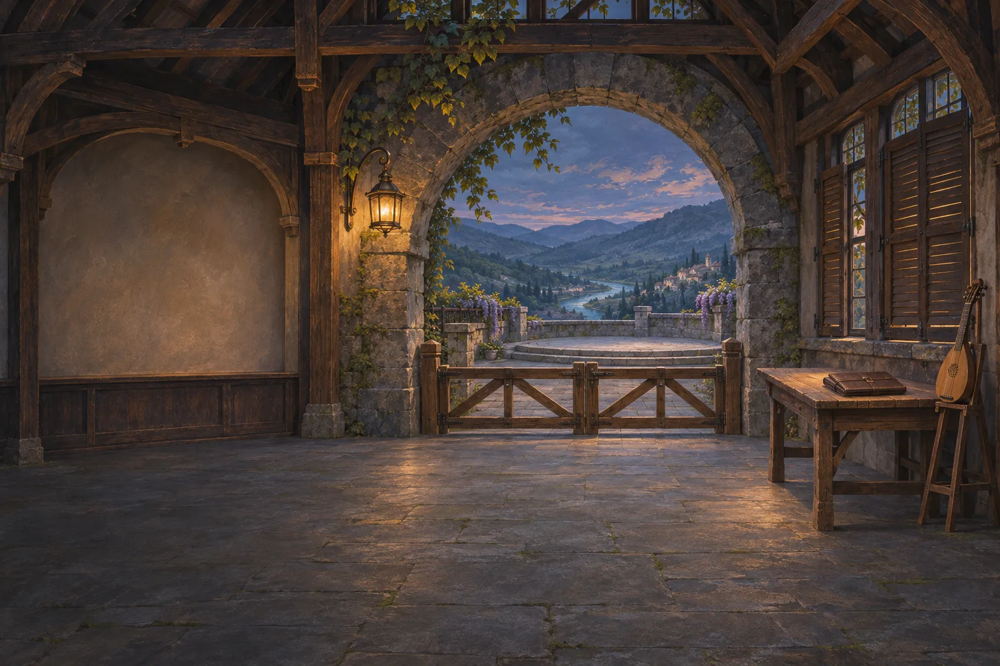
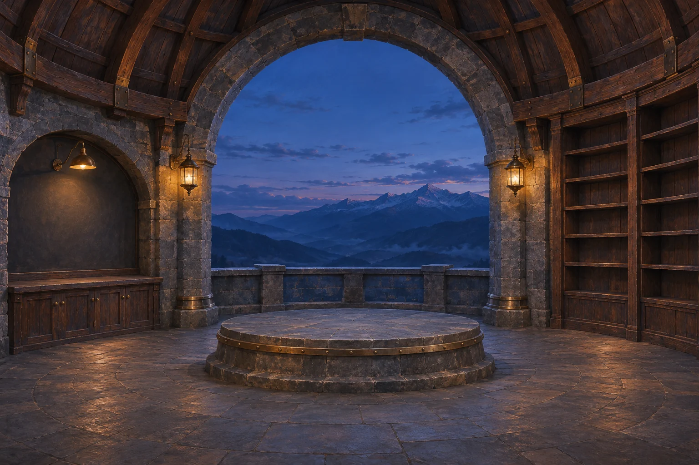
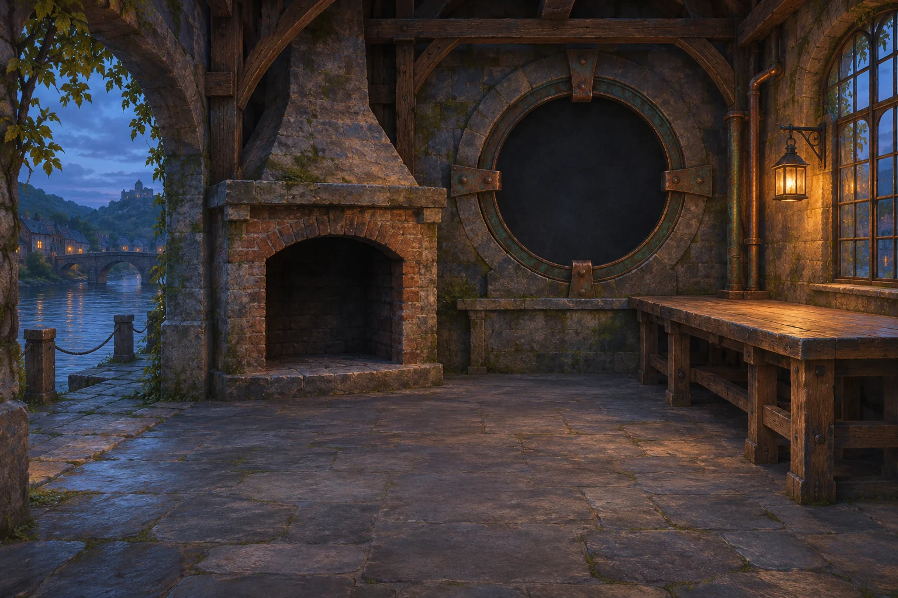
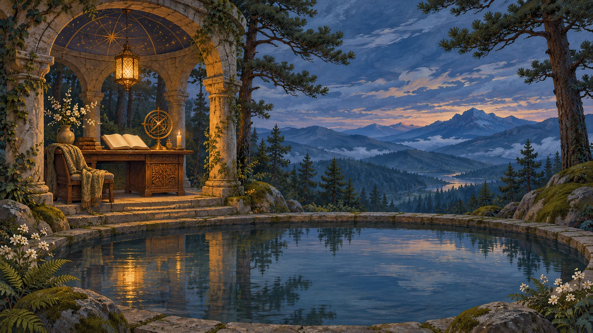
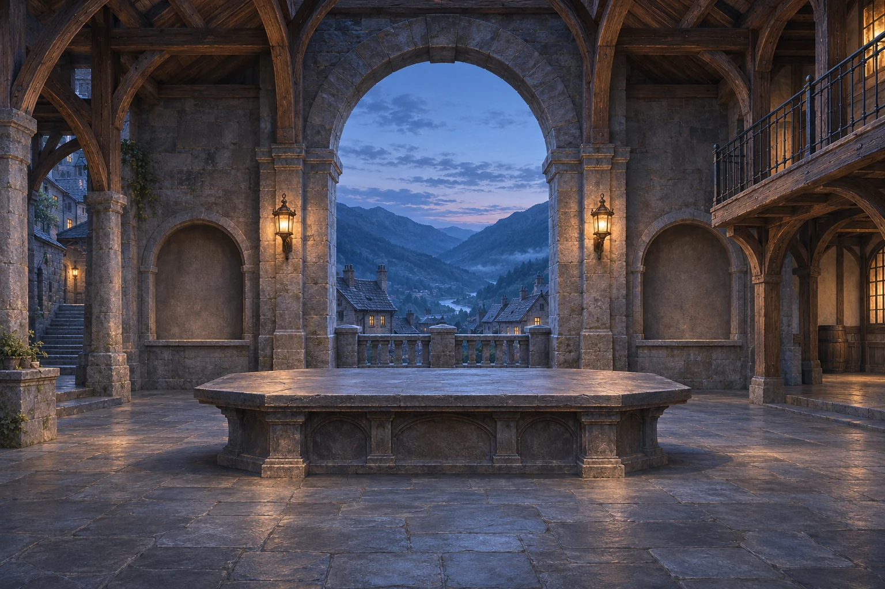
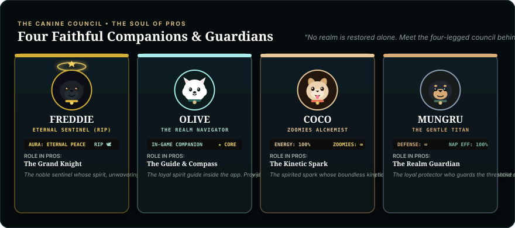
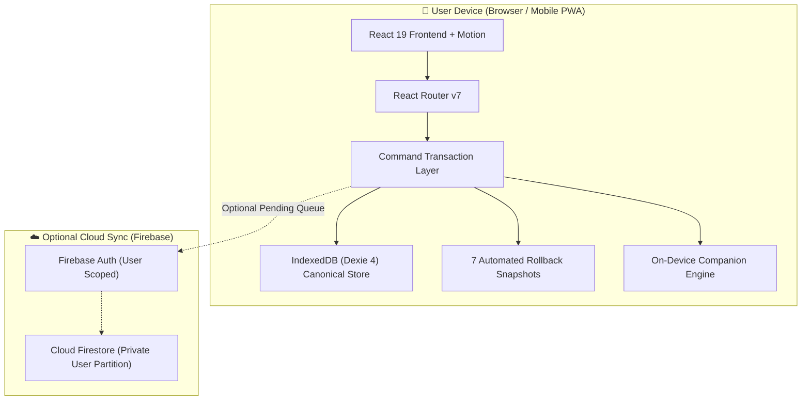

<div align="center">



<br/>

**A mobile-first Personal RPG Operating System: practice real skills, finish meaningful projects, and restore an illustrated world.**

<br/><br/>

[](LICENSE)
[](https://www.typescriptlang.org/)
[](https://react.dev/)
[](https://vite.dev/)
[](docs/DATA-RECOVERY.md)
[%2C%20Olive%2C%20Coco%2C%20Mungru-ff758f?style=for-the-badge)](#-the-canine-council)

<br/>

**[⚡ Quick Start](#-quick-start)** • **[📜 The Manifesto](docs/MANIFESTO.md)** • **[🗺️ Restored World](#-the-six-regions)** • **[🐕 Canine Council](#-the-canine-council)** • **[🛠️ Architecture](#-system-architecture)** • **[👤 The Architect](#-the-architect)**

</div>

---

## ⚡ What is PROS?

> **PROS** stands for **Personal RPG Operating System**.
> It is a mobile-first, local-first software environment that converts genuine, focused human effort into the restoration of an illustrated fantasy realm.

Most productivity software treats you like an unruly employee:
- They punish you with **broken streaks** when you take a needed break or fall ill.
- They spam you with **nag notifications** at dinner.
- They hoard your private journals on cloud servers to train predictive models.

**PROS operates on completely different laws:**

$$\mathbf{1\text{ Minute of Focused Effort}} = \mathbf{1\text{ Character XP}}$$

* **Zero Streak Anxiety:** Taking a week off never damages your character, never degrades unlocked skills, and never resets restored lands.
* **No Artificial XP:** Ticking a checkbox gives you zero XP. Only genuine, reviewed time spent practicing skills or finishing project milestones converts into experience.
* **100% Local-First Sovereignty:** Your data lives strictly inside your browser's IndexedDB via `Dexie.js`. It never leaves your device unless you choose to enable cloud sync.

---

## 🗺️ The Six Restored Regions

As you record real-world effort and produce confirmed creative or technical outputs, you restore six distinct regions across **18 developmental stages** and **24 readable narrative chapters**:

<table>
  <tr>
    <td width="50%" align="center">
      
      <br/>
      <strong>🏡 The Surveyor's Home</strong>
      <br/>
      <em>The quiet hearth where your journey begins, drafts are saved, and priorities take shape.</em>
    </td>
    <td width="50%" align="center">
      
      <br/>
      <strong>🎨 The Riverside Atelier</strong>
      <br/>
      <em>The creative studio restored through writing, design, music, and art practice.</em>
    </td>
  </tr>
  <tr>
    <td width="50%" align="center">
      
      <br/>
      <strong>🔭 The High Observatory</strong>
      <br/>
      <em>The celestial laboratory revitalized through research, reading, and deep scientific inquiry.</em>
    </td>
    <td width="50%" align="center">
      
      <br/>
      <strong>⚒️ The Mountain Foundry</strong>
      <br/>
      <em>The heavy workshop brought to life through software engineering, crafting, and building.</em>
    </td>
  </tr>
  <tr>
    <td width="50%" align="center">
      
      <br/>
      <strong>🌿 The Forest Sanctuary</strong>
      <br/>
      <em>The water garden and moss pavilion honoring meditation, rest, and emotional well-being.</em>
    </td>
    <td width="50%" align="center">
      
      <br/>
      <strong>🏰 The Council Citadel</strong>
      <br/>
      <em>The summit hall where completed masterworks and published projects stand permanently enshrined.</em>
    </td>
  </tr>
</table>

---

## 🐕 The Canine Council

Behind every ambitious software project is a faithful team that provides unconditional love, dispels doubt, and keeps us grounded. PROS is dedicated to and protected by **The Canine Council**:

<div align="center">
  
</div>

<br/>

| Companion | Title & Class | In-Game Role | Story & Spirit |
| :--- | :--- | :--- | :--- |
| 🕊️ **Freddie** *(RIP)* | **The Eternal Sentinel** | *Aura of Eternal Peace* | The wise, steadfast companion whose memory watches over every line of code, reminding us to stay gentle and strong through life's storms. |
| 🐕 **Olive** | **The Realm Navigator** | *On-Device Guidance* | The faithful companion living inside the app who offers quiet project orientation and weekly reflections without nag telemetry. |
| 🐾 **Coco** | **The Zoomies Alchemist** | *Kinetic Spark* | The spirited companion whose infectious joy and sudden bursts of energy shatter creative blocks or late-night fatigue. |
| 🐕‍🦺 **Mungru** | **The Gentle Titan** | *Deep Snooze Ward* | The noble guardian who watches over the threshold and enforces mandatory, guilt-free rest after deep-work marathons. |

---

## 🧭 Core Systems & Experience

```
┌────────────────────────────────────────────────────────────────────────┐
│ PROS CORE LOOP                                                         │
│                                                                        │
│   [Real Effort]  ───▶  [Focus Timer]  ───▶  [Reviewed XP Engine]      │
│         │                                           │                  │
│         ▼                                           ▼                  │
│   [Finished Output]  ──▶  [Relic Foundry]  ──▶  [World Restored]       │
└────────────────────────────────────────────────────────────────────────┘
```

- **Today Dashboard:** A single pinned next action, three focus priorities, and immediate access to quick capture without visual clutter.
- **74 Authored Skills & 222 Project Outputs:** Complete progression paths across disciplines with curated milestones and output ideas. Custom skills preserve their own unique identity.
- **Focus Chamber:** Immersive countdown and stopwatch with persistent state, audio soundscapes, and review checkpoints before time is credited.
- **Olive Companion:** Context-aware, on-device guidance providing smaller next steps and weekly reflections without remote AI calls.
- **Adaptive Atmosphere:** Independent volume mixing for procedural regional melodies, 3 CC0 orchestral tracks, and 2 natural soundscapes (rain, forest).
- **Interactive 3D Keepsakes:** Inspect earned regional relics via WebGL canvas with high-performance CSS fallbacks.

---

## 🛠️ System Architecture



- **Zero-Latency Offline First:** All state mutations execute against local `IndexedDB` first. There is zero loading spinner for offline actions.
- **7 Rolling Recovery Snapshots:** PROS automatically archives rolling transaction checkpoints to guarantee you can revert accidental deletions or schema changes.
- **Encrypted Export & Import:** Full JSON backup and migration utilities built straight into the client settings.

---

## 🚀 Quick Start

### Prerequisites
- **Node.js**: v20+ or v22+
- **pnpm**: v9+ (or npm/yarn)

### 1. Clone & Install
```bash
git clone https://github.com/revaan-mishra/pros-app.git
cd pros-app
pnpm install --frozen-lockfile
```

### 2. Start the Development Server
```bash
pnpm dev
```
Open `http://127.0.0.1:5173` in your browser.

### 3. Build & Preview
```bash
pnpm build
pnpm preview
```

### 4. macOS One-Click Standalone Runner
If you are running on macOS, you can double-click **`Start PROS.command`** directly in Finder (or execute it via terminal):
```bash
./Start\ PROS.command
```
This serves the production bundle on `http://127.0.0.1:4173` with byte-range audio streaming and PWA offline service workers enabled.

---

## 🧪 Verification & Test Suite

PROS maintains an automated test and cryptographic asset verification suite:

```bash
# Run unit and state progression tests (Vitest)
pnpm test

# Verify all CC0 audio tracks, image hashes, and asset licenses
pnpm check:assets

# Test loopback server range requests and deep links
pnpm check:server

# Run Playwright end-to-end browser tests
pnpm test:e2e
```

---

## 👤 The Architect

<div align="center">
  
</div>

<br/>

**PROS** was conceived, architected, and crafted by **Revaan Mishra**.

> *"I grew tired of software that treated my life like a backlog and my habits like quarterly KPIs. PROS was built for people who want to practice real craft, honor their own pace, and build a world they can actually be proud to return to."*
> — **Revaan Mishra**

---

## 📄 License & Credits

- **Software License:** Licensed under the [MIT License](LICENSE).
- **Cartography Art:** Kenney Cartography assets licensed under [CC0 1.0 Universal](public/licenses/kenney-cartography.txt).
- **Soundtrack & Ambience:** "Homestead", "Fairy Lights", and "Wandering Woodlands" licensed under [CC0 1.0 Universal](public/licenses/THIRD-PARTY.txt).
- **Original Illustrations:** Original regional paintings and Olive companion art generated and maintained under cryptographic manifest at `public/licenses/original-artwork.json`.

---

<div align="center">
  <sub>Built with relentless craft by <strong>Revaan Mishra</strong> &amp; protected by <strong>Freddie (RIP), Olive, Coco, and Mungru</strong>.</sub>
</div>
