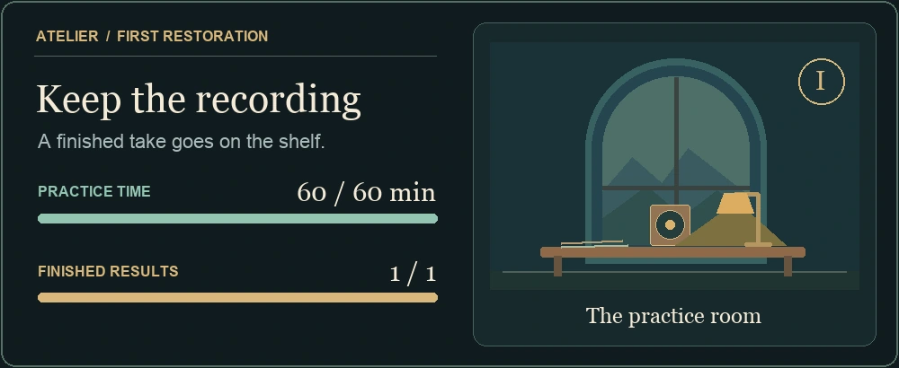

# PROS

**Personal RPG Operating System**

Practice a skill. Finish something you care about. Watch an illustrated world grow from the work you put into it.

[**Install PROS**](https://pros-rpg.web.app/?install=1) · [Open in your browser](https://pros-rpg.web.app/) · [Help](https://pros-rpg.web.app/support.html)

PROS is free and open source. Choose **Explore a sample world** to look around right away. Saving a world of your own in the live beta requires an invitation.

## Put PROS on your Home Screen

1. **Android:** Open the install guide in Chrome. Use **Install on this device** when offered, or open Chrome’s **More** menu and choose **Install app**.
2. **iPhone and iPad:** Open the guide in Safari. Choose **Share → Add to Home Screen**, turn on **Open as Web App** if shown, and tap **Add**.
3. **Open the PROS icon while online.** Try the sample or sign in with your approved account. In **More → Install PROS**, look for **Ready offline** before heading out.

[Open the installation guide](https://pros-rpg.web.app/?install=1) · [See the quick start](docs/QUICK-START.md)

## One evening in the Atelier

Say you’ve been learning a guitar part. On **Today**, log the time you spent practicing. In **Quests**, give yourself a small finish line, like keeping one clean take of the verse. When you record that finished result, it might become a keepsake on your shelf. With enough practice and finished work, the workshop comes back to life.

[Watch the workshop light up](docs/assets/field-guide/atelier-first-light.gif)

<picture>
  <source media="(max-width: 640px)" srcset="docs/assets/field-guide/today-mobile.jpg">
  
</picture>

*Today in the sample world. Its records are separate from your own.*

Where to find things

- **Today** puts your next action, timer, and activity log within reach.
- **Quests** holds projects, routines, and the small steps that move them along.
- **Skills** shows how your practice adds up and lets you find something new to learn.
- **World** shows what each of the six regions needs to grow.
- **Character** holds your portrait, wardrobe, and milestones.
- **More** brings together your Journal, Library, Chronicle, settings, and sound.

Take a break when you need one. Your progress and world will be there when you return.

A page from the atlas

> Olive has dragged a strip of paper out from under the cabinet. She’s a small, entirely white dog, except for one muddy paw. She sets it on your boot and waits to see if you understand what a good find this is.
>
> The strip reads **Upper path open on foot at dusk.** On the atlas spread across the table, a broad black stamp covers the river crossing. **THE CROSSING IS CLOSED.**
>
> You turn the strip over. Somebody has pencilled a little arrow on its back. It points toward a house.

*From the PROS lore draft.*

## Supervised from the cushion

Freddie gets the gold star and the first chair. Olive, the little white Spitz, is the companion you’ll meet on Today. Coco handles playtime, and Mungru has already found the best spot to nap.

Built by Revaan Mishra, under close canine supervision. [Revaan on GitHub](https://github.com/revaan-mishra)

## Need a hand?

- **Install or sign in.** Find steps for each device and help with invitations and email verification. [Support guide](https://pros-rpg.web.app/support.html)
- **Keep a copy of your world.** Export a backup from **Settings → Data and recovery**. [Privacy](https://pros-rpg.web.app/privacy.html) · [Backup and recovery](docs/DATA-RECOVERY.md)
- **Report something broken.** Include what you tapped and which browser or phone you used. Keep personal records out of public reports. [GitHub issues](https://github.com/revaan-mishra/pros-app/issues)

Build it yourself or contribute

Use Node 24 LTS and pnpm 11. Run `pnpm install --frozen-lockfile`, then `pnpm dev`. The local app opens a sample or a device profile without Firebase setup. [Build and host PROS](docs/DEPLOYMENT.md) · [Contributing](CONTRIBUTING.md)

The `native/` folder contains the open-source Capacitor projects for development. The Android download is planned for after native reminders and private account restore have been tested on a physical phone. [Native build guide](docs/NATIVE-MOBILE.md)

[MIT License](LICENSE) · [Artwork and music credits](public/licenses/THIRD-PARTY.txt)
