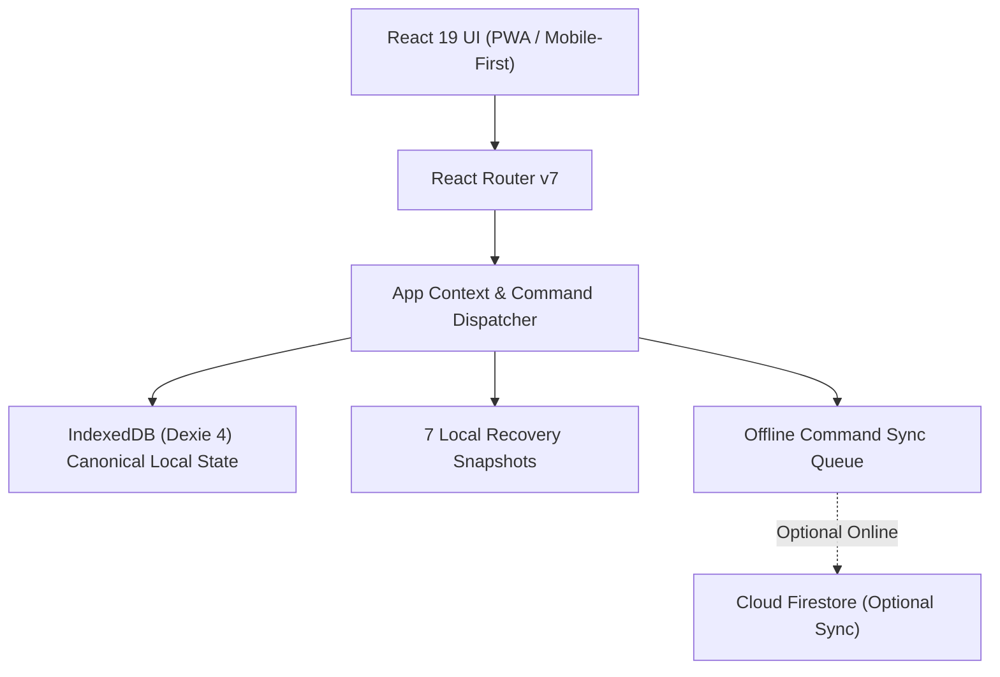

<div align="center">

# ⚔️ PROS · A World of Your Making

**An iPhone-first personal RPG: practice real skills, finish meaningful projects, and restore an illustrated world.**

[](LICENSE)
[](https://www.typescriptlang.org/)
[](https://react.dev/)
[](https://vite.dev/)
[](docs/DATA-RECOVERY.md)
[](https://web.dev/progressive-web-apps/)

[Quick Start](#-quick-start) • [Architecture](#-architecture--tech-stack) • [Core Pillars](#-core-pillars) • [Documentation](#-documentation) • [Asset Licenses](#-asset-licenses)

</div>

---

## 🌟 Overview

**PROS** is a standalone, open-source personal progression RPG and habit/project tracking application designed with an iPhone-first, local-first philosophy.

Unlike conventional productivity tools that rely on punitive streaks, guilt mechanics, or gamified vanity metrics, PROS respects your time:
- **Progress is cumulative:** Every minute of genuine work directly earns character experience points ($1\text{ minute} = 1\text{ XP}$).
- **Zero penalty for absence:** Taking a break never damages your character, resets your level, or degrades restored territories.
- **Finished work restores the world:** Completing milestones in your real life revitalizes 6 regional landscapes, unlocks lore chapters, and discovers handcrafted relics.

---

## 🧭 Core Pillars

| Pillar | Description |
| :--- | :--- |
| **⏳ Honest Effort** | $1\text{ minute focused effort} = 1\text{ Character XP}$. Checklists and output counters never invent artificial effort. |
| **🗺️ World Restoration** | 6 illustrated regions (Home, Atelier, Observatory, Foundry, Training Grounds, Citadel) restored across 18 stages and 24 readable chapters. |
| **🐕 Olive the Companion** | An on-device white Spitz companion providing quiet, contextual guidance, smart capture, and zero nag notifications. |
| **🧭 3D Artifacts & Relics** | Interactive WebGL compass and regional relic inspection with lightweight, accessible CSS fallbacks. |
| **🎵 Adaptive Atmosphere** | Original regional generative scores, CC0 music recordings, and natural soundscapes (forest, water) with discrete volume controls. |
| **🛡️ Local-First Resilience** | All data lives client-side in IndexedDB (`Dexie`). Includes 7 automated local rollback snapshots, Undo transactions, and optional Firebase sync. |

---

## 📱 The Experience

- **Today:** Single next action, three daily priorities, quick capture, and effortless review.
- **Quests:** Actions, recurring rituals, and long-term projects with clear separation between pause, reschedule, archive, and complete.
- **Skills:** 26 starter skills plus 48 unlockable disciplines with 74 authored curriculum guides and 222 project output prompts.
- **Focus Timer:** Immersive stopwatch / countdown with recovery, ambient sound, and review before time converts to XP.
- **Chronicle & Journal:** Complete historical log linked to verified project outputs and on-demand weekly recaps.
- **Smart Capture:** Single-line free text input that parses task intent, skill associations, and durations without remote AI calls.

---

## 🛠️ Architecture & Tech Stack



- **Framework:** [React 19](https://react.dev/) + [TypeScript](https://www.typescriptlang.org/)
- **Build Tool:** [Vite](https://vite.dev/) with [vite-plugin-pwa](https://vite-pwa-org.netlify.app/)
- **Local Database:** [Dexie.js](https://dexie.org/) (IndexedDB wrapper) with transactional rollback
- **Animation & 3D:** [Motion](https://motion.dev/) + WebGL procedural canvas
- **Cloud Backend (Optional):** [Firebase 13](https://firebase.google.com/) Auth & Cloud Firestore with strict document security rules

---

## 🚀 Quick Start

### Prerequisites

- **Node.js**: `20.x` or `22.x`
- **pnpm**: `9.x` or later (or npm / yarn)

### 1. Clone & Install

```bash
git clone https://github.com/revaan-mishra/pros-app.git
cd pros-app
pnpm install --frozen-lockfile
```

### 2. Run the Development Server

```bash
pnpm dev
```

Open `http://127.0.0.1:5173` in your browser.

### 3. Build & Production Preview

```bash
pnpm build
pnpm preview
```

### 4. macOS One-Click Launcher

If running on macOS, you can execute the included launcher script:

```bash
./Start\ PROS.command
```

This serves the production build at `http://127.0.0.1:4173` with byte-range support and offline PWA caching enabled.

---

## 🧪 Verification & Testing

PROS includes a robust automated test and asset integrity suite:

```bash
# Run unit and state verification tests (Vitest)
pnpm test

# Verify all CC0 media, audio checksums, and artwork manifests
pnpm check:assets

# Test local HTTP range server and deep linking
pnpm check:server

# Run Playwright end-to-end suite
pnpm test:e2e
```

---

## ☁️ Optional Cloud Synchronization

PROS works 100% offline out-of-the-box. If you wish to enable private cross-device sync via Firebase:

1. Copy the example configuration:
   ```bash
   cp .env.example .env.local
   ```
2. Populate the Firebase environment variables from your Firebase Console:
   ```ini
   VITE_FIREBASE_API_KEY=your-api-key
   VITE_FIREBASE_AUTH_DOMAIN=your-project.firebaseapp.com
   VITE_FIREBASE_PROJECT_ID=your-project-id
   VITE_FIREBASE_APP_ID=your-app-id
   VITE_REQUIRE_CLOUD=false
   ```
3. Deploy Firestore security rules:
   ```bash
   firebase deploy --only firestore:rules
   ```

See [docs/CLOUD-OPERATIONS.md](docs/CLOUD-OPERATIONS.md) for full deployment and emulator guidelines.

---

## 📂 Repository Structure

```text
pros-app/
├── docs/                     # Architectural specs, launch kit, design decisions
│   ├── AI-COACH-RESEARCH.md  # Research into offline vs. remote AI assistance
│   ├── ART-AND-AUDIO.md      # Full asset licensing, audio credits & provenance
│   ├── CLOUD-OPERATIONS.md   # Firebase emulator, rules, and deployment gates
│   ├── DATA-RECOVERY.md      # IndexedDB schemas, backup/restore & rollback logic
│   ├── EXPERIENCE-OVERHAUL-PLAN.md # Blueprint for gameplay & UI systems
│   └── QUICK-START.md        # First-use manual and backup directions
├── public/                   # Static web assets & media
│   ├── art/                  # WebP regional illustrations & cartography icons
│   ├── audio/                # CC0 ambient music tracks & soundscapes
│   ├── icons/                # PWA icons & manifest assets
│   └── licenses/             # Attribution manifests & license texts
├── scripts/                  # Build verification, asset hashing, and HTTP scripts
├── src/                      # Application source code
│   ├── assistance/           # Olive companion logic & smart capture parser
│   ├── cloud/                # Firebase adapter & local offline sync queue
│   ├── components/           # Reusable React components & WebGL relic view
│   ├── experience/           # Main feature views (Today, Quests, World, Focus)
│   ├── App.tsx               # Root application component
│   ├── main.tsx              # Application entry point
│   └── storage.ts            # Dexie database initialization & transactions
├── tests/                    # Cloud rules and E2E specifications
├── package.json
├── pnpm-lock.yaml
├── Start PROS.command        # macOS standalone runner
├── tsconfig.json
└── vite.config.ts
```

---

## 🎨 Asset Licenses & Attributions

- **Cartography Icons**: Hand-crafted icons by [Kenney](https://kenney.nl/) under [CC0 1.0 Universal](public/licenses/kenney-cartography.txt).
- **Sound & Music**: Ambient tracks ("Homestead", "Fairy Lights", "Wandering Woodlands") and nature recordings under [CC0 1.0 Universal](public/licenses/THIRD-PARTY.txt).
- **Original Artwork**: Authored regional illustrations and companion art created specifically for PROS. Cryptographic hashes and production briefs are maintained in `public/licenses/original-artwork.json`.

---

## 📄 License

This project is licensed under the [MIT License](LICENSE).
