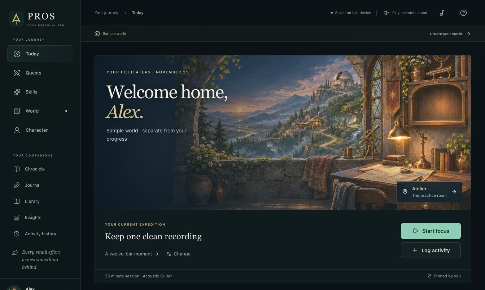
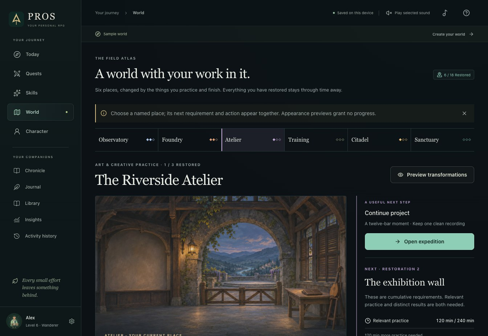

# PROS

**Personal RPG Operating System**

PROS is a free, open-source RPG for the things you do away from the screen. Record the time you spend learning or making something. Keep a finished result when you have one. Over time, the rooms in an illustrated valley open, fill up, and give you places to come back to.

[**Open PROS**](https://pros-rpg.web.app/) · [**Install on Android or iPhone**](https://pros-rpg.web.app/?install=1) · [Explore the valley](https://pros-rpg.web.app/about.html)

Choose **Explore a sample world** from the opening screen. You can try the timer, log practice, and look around without making an account. The live beta accepts private accounts by invitation.

<picture>
  <source media="(max-width: 600px)" srcset="public/showcase/today.jpg">
  
</picture>

*The sample world opens with a guitar project pinned to Today. A new world starts with the project you choose.*

## The save that changes a room

You’ve practiced the verse for 35 minutes. Tonight you put in another 25, then record that you finished one clean take. That meets the Atelier’s first requirement of **60 minutes of relevant practice and one finished result**. The practice room opens, and the finished result has a place on your shelf.

[**Try the restoration yourself**](https://pros-rpg.web.app/about.html#atelier) · [Watch an illustrated version](docs/assets/field-guide/atelier-first-light.gif)


Practice earns experience as you go. Finished work gives a project a finish you can see, whether it’s a sketch, a working tool, or the first conversation you can have in another language. When you correct a record, PROS shows how its connected progress will change. Time away leaves your world intact.

## Three things to try first

1. **Record a short session.** From Today, use **Log activity**. Pick a skill and one of the time presets, or describe the session in a line and review the suggested fields.
2. **See where it counted.** Open **World**, choose **Atelier**, and look at the practice and finished work it still needs. **Preview transformations** lets you see later stages.
3. **Leave yourself a way back in.** Pin a project and give it a next action small enough to begin tomorrow. If you use Focus, leave a continuation note when you review the session.

[Start with the sample](https://pros-rpg.web.app/) · [First-session guide](docs/QUICK-START.md)

## The valley is yours to explore

Six regions give different kinds of work a home. There are **110 authored skill paths**, and you can add your own.

| Place | A first result to keep |
| --- | --- |
| **Observatory** | Explain one idea from a book in your own words. |
| **Foundry** | Fix a small thing and record how you checked it. |
| **Atelier** | Keep one take, a sketch, or a finished page. |
| **Training Grounds** | Record a movement you can now do with control. |
| **Citadel** | Rehearse a short talk you can deliver clearly. |
| **Sanctuary** | Try a focus routine and write down what you learned. |

<details>
<summary>See the World screen</summary>



Each region has three restoration stages, and its requirements are visible from the start. Finished results can become keepsakes. Character has a wardrobe of regional rewards and a 3D wayfinder with an illustrated fallback.

</details>

## A place for ordinary days

**Today** gives you somewhere to start. **Quests** holds routines and projects. **Focus** keeps the timer and your place when you step away, then asks you to review the time. **Chronicle** shows where your effort went. Journal, Library, and Insights have their own places under **More** on phones.

**Olive** can help you choose a next step small enough to do today. The written guide and activity parser run on your device. The optional local model has its own download. Sound starts off. The listening room lets you choose music, nature sounds, or silence. [Experience guide](docs/ENHANCEMENTS.md) · [Olive and local AI](docs/LOCAL-AI.md)

**Your work saves on this device first.** Open an initialized world offline after the install guide shows **Ready offline**. An approved account lets you restore your world on another device when online. Keep a backup from **Settings → Data and recovery** if you want a copy outside the app. [Privacy](https://pros-rpg.web.app/privacy.html) · [Backup guide](docs/DATA-RECOVERY.md)

<details>
<summary>A page from the atlas</summary>

> Olive has dragged a strip of paper out from under the cabinet. She’s a small, entirely white dog, except for one muddy paw. She sets it on your boot and waits to see if you understand what a good find this is.
>
> The strip reads **Upper path open on foot at dusk.** On the atlas spread across the table, a broad black stamp covers the river crossing. **THE CROSSING IS CLOSED.**
>
> You turn the strip over. Somebody has pencilled a little arrow on its back. It points toward a house.

*From the PROS lore draft.*

</details>

## The Canine Council


Freddie keeps the first chair. Olive, the little white Spitz, keeps you company in the app. Coco calls playtime, and Mungru keeps the best spot to nap.

Made by Revaan Mishra, supervised from the cushion. [Revaan on GitHub](https://github.com/revaan-mishra)

## Find your way

- **Play or install.** PROS opens in your browser and installs on Android and iPhone from the same address. [Install PROS](https://pros-rpg.web.app/?install=1)
- **Get help.** Find answers about invitations, email verification, moving devices, and recovering work. [Support](https://pros-rpg.web.app/support.html)
- **See what’s available.** Start with the player guides, or browse the build, native development, and release notes. [Documentation](docs/README.md)

<details>
<summary>Build it yourself or contribute</summary>

Use Node 24 LTS and pnpm 11. Run these commands from the checkout.

```sh
pnpm install --frozen-lockfile
pnpm dev
```

Open the address printed by the dev server. It can use the sample and local profiles without a Firebase project. The native folders contain development projects for iOS and Android. The signed Android download is planned after native reminders and account restoration are checked on a physical phone.

[Contributing](CONTRIBUTING.md) · [Build and hosting](docs/DEPLOYMENT.md) · [Native development](docs/NATIVE-MOBILE.md) · [Build checks](https://github.com/revaan-mishra/pros-app/actions/workflows/verify.yml)

</details>

[MIT License](LICENSE) · [Artwork and music credits](public/licenses/THIRD-PARTY.txt) · [How the showcase was made](docs/SHOWCASE.md)
