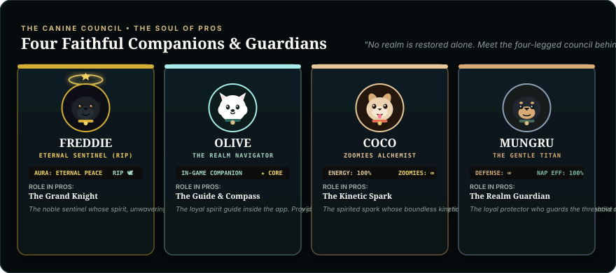

# The PROS manifesto

*Design principles for PROS, created by Revaan Mishra.*

## Progress survives a break

A calendar can help you find a rhythm. The work you did still matters after a day off, a difficult week, or a longer absence. PROS keeps the progress you've recorded and gives you a place to resume.

## Effort builds experience

One credited minute earns one character XP. A completed task describes what you finished. A confirmed output records something you made or learned and helps restore its region. A recording, an explanation, or a working prototype is worth keeping in its own right.

That distinction keeps the game connected to the practice it represents. Review your time before saving, and keep the freedom to correct it later.

## Your records are yours to keep

PROS commits work to the browser first. Export it as readable JSON, review competing changes, and recover from local snapshots when available. Account builds can synchronize to private Firebase paths. Olive's written guidance works on the device with the project you choose. [Data recovery](DATA-RECOVERY.md)

## The Canine Council

PROS is dedicated to four companions who bring some play and perspective to the work.

- **Freddie, the Eternal Sentinel.** In memory of a steadfast companion.
- **Olive, the Realm Navigator.** The small white Spitz who sits beside your projects in the app.
- **Coco, the Zoomies Alchemist.** A reminder to make room for play.
- **Mungru, the Gentle Titan.** A reminder to take time to rest.
